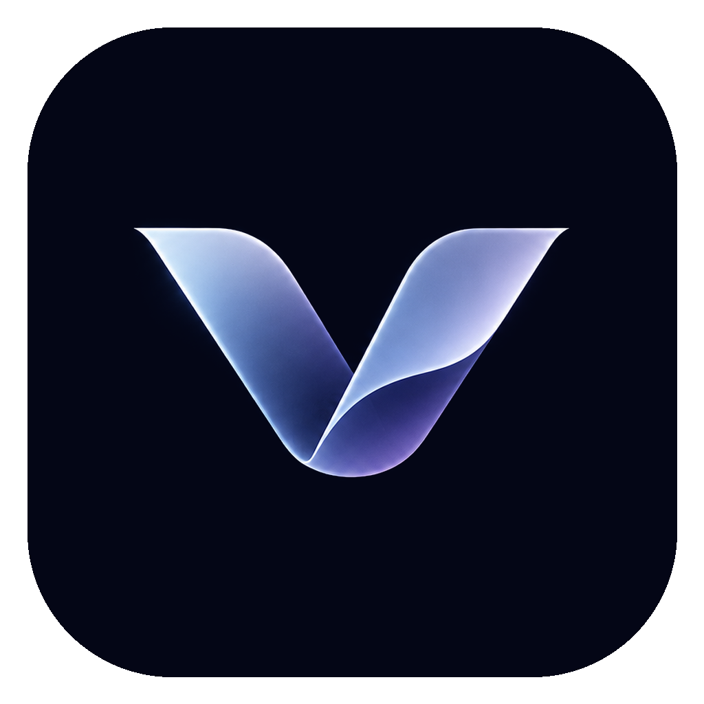

<p align="center"></p>

# Veyra

*Your intelligence, always within reach.*

Veyra is an independent desktop AI assistant for Windows and macOS. It lives behind a small floating toggle that you place anywhere on your screen, and it is designed to run **locally** (llama.cpp + a single general-purpose model), with no Veyra server, no telemetry and no account.

> **Status: early development (v0.1.0 – foundations).** Read [docs/ROADMAP.md](docs/ROADMAP.md) for exactly what works today and what does not. Nothing is claimed as working unless it is listed there as *implemented* and *verified*.

## What exists today (Phase 1, in progress)
- Floating toggle: free drag, snapping to the four edges and four corners, margins, multi-monitor placement, position remembered, size / shape / colour / opacity / shadow / reflection / animation settings, always-on-top option.
- Panel window opened by the toggle (settings for the toggle and theme; the chat itself is Phase 2).
- Settings stored locally (atomic writes, corrupt files set aside, never deleted).
- Zero network access: the app makes no connection of any kind, and the webview CSP forbids remote content.
- CI that builds Windows, macOS Apple Silicon and macOS Intel installers and refuses to pass if an installer is missing.

## Documentation
| | |
|---|---|
| [docs/ARCHITECTURE.md](docs/ARCHITECTURE.md) | Technology comparison, decisions, security and privacy model |
| [docs/ROADMAP.md](docs/ROADMAP.md) | Every requirement, its phase and its verification status |
| [docs/BUILD.md](docs/BUILD.md) | Local build, CI, releases, signing and notarisation |

## Quick start (development)
```bash
npm ci
npm run tauri dev
```
Requirements: Node 22, Rust 1.97 and the [Tauri system prerequisites](https://v2.tauri.app/start/prerequisites/). Details in [docs/BUILD.md](docs/BUILD.md).

## Name
"Veyra" is a working name. Pending third-party trademark filings for VEYRA / VEYRA AI exist in other classes (see ARCHITECTURE.md §9); this is not a legal clearance.
